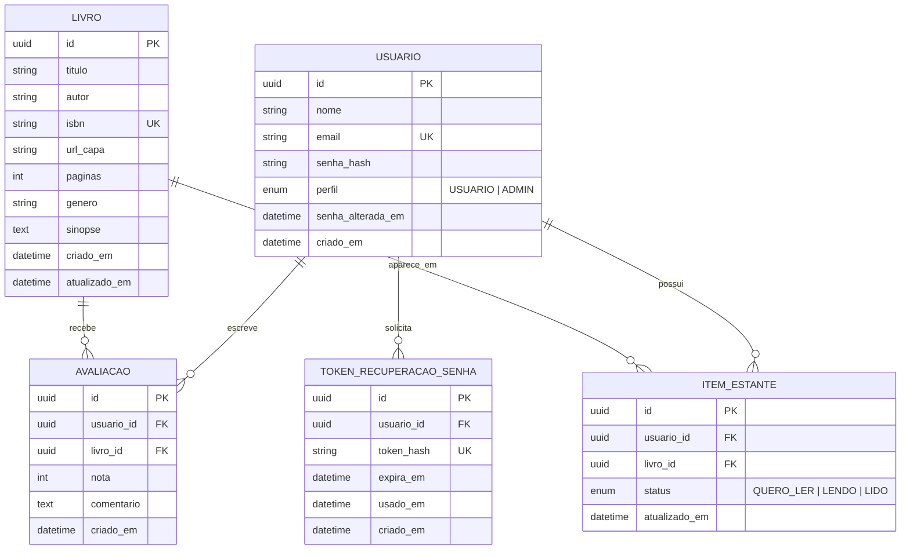

# Estante API

API REST em Node.js para catálogo de livros, avaliações e estante de leitura.

## Sobre o sistema

O administrador cadastra os livros no catálogo; os leitores organizam sua estante pessoal (quero ler, lendo, lido) e avaliam os livros que já leram. Sistema da categoria **reviews**.

**API externa:** [Open Library](https://openlibrary.org/developers/api) (veja a seção "API externa" abaixo).

## Entidades

- **Usuário**: perfil `USUARIO` ou `ADMIN`.
- **Livro**: título, autor, ISBN, capa, páginas, gênero, sinopse.
- **Avaliação**: nota (1 a 5) e comentário de um usuário sobre um livro.
- **Item da estante**: status do livro para o usuário (`QUERO_LER`, `LENDO`, `LIDO`).

## DER



`AVALIACAO` e `ITEM_ESTANTE` têm par único (`usuario_id`, `livro_id`). A nota é limitada de 1 a 5 por uma restrição `CHECK` no banco. Ao excluir um usuário ou livro, suas avaliações e itens de estante são excluídos em cascata. `TOKEN_RECUPERACAO_SENHA` é uma tabela de apoio (guarda só o hash do token) e não conta como entidade de negócio. `senha_alterada_em` registra a última troca de senha e é usada para encerrar as sessões antigas.

## Regras de negócio e permissões

**Livros**
- O catálogo é público: qualquer pessoa lista, busca e consulta livros.
- Só o `ADMIN` cadastra, edita e remove livros. O ISBN (opcional) é único.
- Ao remover um livro, as avaliações e os itens de estante dele são removidos junto.
- A média das notas e o total de avaliações são calculados a partir das avaliações e vêm junto com o livro.

**Estante** (pessoal: cada usuário só vê e altera os próprios itens)
- O usuário adiciona um livro com um status: `QUERO_LER`, `LENDO` ou `LIDO`. Cada livro aparece uma vez por estante.
- Itens de outro usuário respondem 404, como se não existissem.
- Um livro avaliado não pode mudar de `LIDO` nem sair da estante enquanto a avaliação existir.

**Usuários**
- O usuário edita o próprio nome e troca a própria senha (exige a senha atual).
- O usuário exclui a própria conta, confirmando a senha. Suas avaliações e itens de estante saem junto.
- O `ADMIN` exclui usuários comuns. **Contas de administrador não podem ser excluídas** (o sistema nunca fica sem administrador).

**Avaliações**
- Só avalia quem marcou o livro como `LIDO`. Uma avaliação por usuário e livro. Nota de 1 a 5, comentário opcional.
- Só o dono edita a avaliação.
- O dono exclui a própria avaliação, e o `ADMIN` exclui qualquer uma (moderação).

| Perfil | Pode |
|---|---|
| Visitante | Ver o catálogo e as avaliações; cadastrar-se, entrar e recuperar a senha |
| `USUARIO` | Tudo do visitante, mais: gerir a própria estante, avaliar livros lidos, editar e excluir as próprias avaliações |
| `ADMIN` | Tudo do usuário, mais: gerir o catálogo de livros (inclusive buscar na Open Library), excluir qualquer avaliação, listar usuários e excluir usuários comuns |

## Banco de dados

PostgreSQL com [Prisma](https://www.prisma.io/). O esquema fica em `prisma/schema.prisma` e as migrations em `prisma/migrations/`. As migrations são aplicadas automaticamente quando o container da API inicia.

## Como executar

Pré-requisitos: Docker e Docker Compose. (Nos exemplos usamos `docker compose`; em instalações antigas, o comando equivalente é `docker-compose`.)

1. Crie o arquivo de ambiente:

       cp .env.example .env

2. Edite o `.env` e troque os valores marcados com `[TROCAR]`: `BANCO_SENHA` (apenas letras e números), `SEGREDO_JWT` e `ADMIN_SENHA`. Para gerar um segredo JWT:

       node -e "console.log(require('crypto').randomBytes(48).toString('hex'))"

   (sem Node instalado, use qualquer sequência aleatória com 32 caracteres ou mais)

3. Suba o ambiente:

       docker compose up --build

Verificação: `GET http://localhost:3000/saude` deve retornar `{"status":"ok","banco":"conectado"}`.

| Serviço | Endereço |
|---|---|
| API | http://localhost:3000 |
| Mailpit (caixa de e-mails de teste) | http://localhost:8025 |
| Front-end (repositório `estante-web`) | http://localhost:5173 |

Observações:

- A senha do banco existe em um único lugar (`BANCO_SENHA`); a URL de conexão é montada pelo `docker-compose.yml`.
- O banco só lê usuário e senha na **primeira** criação. Se trocar `BANCO_USUARIO` ou `BANCO_SENHA` depois, rode `docker compose down -v` (apaga os dados locais) e suba de novo.
- O front-end precisa rodar no endereço de `URL_FRONTEND`. Se usar outra porta, altere essa variável e reinicie a API (do contrário o CORS bloqueia as chamadas).
- O administrador inicial é criado automaticamente com `ADMIN_EMAIL` e `ADMIN_SENHA` do `.env`.
- Testes automáticos (sem banco): `npm install && npm test`.

## Autenticação e permissões

Login por e-mail e senha com JWT (expira em `EXPIRACAO_JWT`). Rotas protegidas exigem o cabeçalho `Authorization: Bearer <token>`.

As permissões de cada perfil estão na seção "Regras de negócio e permissões".

Segurança aplicada:

- Senhas com hash bcrypt; o perfil nunca vem do cliente (todo cadastro é `USUARIO`) e, a cada requisição, é lido do banco, não do token.
- A cada requisição autenticada, a sessão é conferida no banco: token de conta excluída é recusado (401) e **toda troca de senha (pelo perfil ou pelo link do e-mail) encerra as sessões anteriores**.
- Login responde a mesma mensagem para e-mail inexistente e senha errada.
- Limite de requisições por IP: 600 a cada 15 minutos na API toda e 50 a cada 15 minutos nas rotas `/auth`.
- Validação de todas as entradas com Zod; cabeçalhos de segurança (Helmet); CORS restrito ao front.
- Erros padronizados no middleware global, sem detalhes internos; erros conhecidos do banco viram 400, 404 ou 409.

### Recuperação de senha

1. `POST /auth/esqueci-senha` com o e-mail. A resposta é sempre a mesma, exista ou não a conta.
2. A API gera um token aleatório, guarda **somente o hash** dele (válido por `VALIDADE_TOKEN_SENHA_MINUTOS`, uso único) e envia o link por e-mail. Um novo pedido invalida os anteriores. Ao redefinir a senha, as sessões antigas da conta são encerradas.
3. O e-mail chega no Mailpit (http://localhost:8025) com o link `URL_FRONTEND/redefinir-senha?token=...`.
4. `POST /auth/redefinir-senha` com o token e a nova senha.

## Endpoints

| Método e caminho | Acesso | Corpo | Respostas |
|---|---|---|---|
| `POST /auth/cadastro` | Público | `nome` (2-100), `email`, `senha` (8-72) | 201 `{usuario}`; 400 dados inválidos; 409 e-mail já cadastrado |
| `POST /auth/login` | Público | `email`, `senha` | 200 `{token, usuario}`; 401 credenciais inválidas |
| `POST /auth/esqueci-senha` | Público | `email` | 200 `{mensagem}` |
| `POST /auth/redefinir-senha` | Público | `token`, `novaSenha` (8-72) | 200 `{mensagem}`; 400 token inválido ou expirado |
| `GET /auth/eu` | Autenticado | (nenhum) | 200 `{usuario}`; 401 |
| `GET /usuarios` | `ADMIN` | (nenhum) | 200 `{usuarios}`; 401; 403 |
| `PATCH /usuarios/eu` | Autenticado | `nome` (2-100) | 200 `{usuario}`; 400; 401 |
| `PATCH /usuarios/eu/senha` | Autenticado | `senhaAtual`, `novaSenha` (8-72) | 200; 400 senha atual incorreta; 401 |
| `DELETE /usuarios/eu` | Autenticado | `senha` (confirmação) | 204; 400 senha incorreta; 403 conta de administrador |
| `DELETE /usuarios/:id` | `ADMIN` | (nenhum) | 204; 400; 403 (alvo é administrador ou sem permissão); 404 |
| `GET /saude` | Público | (nenhum) | 200 API e banco ok; 503 banco fora |
| `GET /livros` | Público | query: `busca`, `pagina` (1), `limite` (12, máx. 50) | 200 `{itens, pagina, limite, total, totalPaginas}` |
| `GET /livros/externo/busca` | `ADMIN` | query: `titulo` (2-100) | 200 `{resultados}` (candidatos da Open Library); 400; 403; 502 API externa fora |
| `GET /livros/externo/obras/:idObra` | `ADMIN` | `idObra` no formato `OL123W` | 200 `{detalhes: {sinopse}}`; 400; 403; 404; 502 |
| `GET /livros/:id` | Público | (nenhum) | 200 `{livro}` com `mediaNota` e `totalAvaliacoes`; 400 id inválido; 404 |
| `POST /livros` | `ADMIN` | `titulo`, `autor`; opcionais: `isbn`, `urlCapa`, `paginas`, `genero`, `sinopse` | 201 `{livro}`; 400; 401; 403; 409 ISBN repetido |
| `PATCH /livros/:id` | `ADMIN` | qualquer campo de livro (ao menos um); `null` limpa um campo opcional | 200 `{livro}`; 400; 403; 404; 409 |
| `DELETE /livros/:id` | `ADMIN` | (nenhum) | 204; 403; 404 |
| `GET /livros/:id/avaliacoes` | Público | (nenhum) | 200 `{avaliacoes}` (com nome do autor); 404 |
| `POST /livros/:id/avaliacoes` | Autenticado | `nota` (1-5), `comentario` opcional | 201 `{avaliacao}`; 400; 403 livro não lido; 404; 409 já avaliou |
| `PATCH /avaliacoes/:id` | Dono | `nota` e/ou `comentario` | 200 `{avaliacao}`; 400; 403; 404 |
| `DELETE /avaliacoes/:id` | Dono ou `ADMIN` | (nenhum) | 204; 403; 404 |
| `GET /estante` | Autenticado | query opcional: `status` | 200 `{itens}` (cada item com o `livro`) |
| `POST /estante` | Autenticado | `livroId`, `status` | 201 `{item}`; 400; 404; 409 já está na estante |
| `PATCH /estante/:id` | Dono do item | `status` | 200 `{item}`; 400; 404; 409 livro avaliado |
| `DELETE /estante/:id` | Dono do item | (nenhum) | 204; 404; 409 livro avaliado |

### Exemplos de requisição e resposta

Nas rotas protegidas, envie `Authorization: Bearer <token>` (o token vem do login). Os valores `...` mudam a cada execução.

Login (público):

    POST /auth/login
    {"email": "admin@estante.local", "senha": "sua_senha_admin"}

    200 OK
    {"token": "eyJhbGciOi...", "usuario": {"id": "...", "nome": "Administrador", "email": "admin@estante.local", "perfil": "ADMIN", "criadoEm": "..."}}

Cadastro (público):

    POST /auth/cadastro
    {"nome": "Maria Silva", "email": "maria@exemplo.com", "senha": "senha12345"}

    201 Created
    {"usuario": {"id": "...", "nome": "Maria Silva", "email": "maria@exemplo.com", "perfil": "USUARIO", "criadoEm": "..."}}

Erro de validação:

    POST /auth/cadastro
    {"nome": "M", "email": "invalido", "senha": "123"}

    400 Bad Request
    {"erro": "Dados inválidos.", "detalhes": [{"campo": "nome", "mensagem": "O nome deve ter pelo menos 2 caracteres."}, {"campo": "email", "mensagem": "E-mail inválido."}, {"campo": "senha", "mensagem": "A senha deve ter pelo menos 8 caracteres."}]}

Cadastrar livro (`ADMIN`; o ISBN é guardado sem hífens):

    POST /livros
    {"titulo": "Dom Casmurro", "autor": "Machado de Assis", "isbn": "978-85-359-0277-5", "paginas": 256, "genero": "Romance"}

    201 Created
    {"livro": {"id": "...", "titulo": "Dom Casmurro", "autor": "Machado de Assis", "isbn": "9788535902775", "urlCapa": null, "paginas": 256, "genero": "Romance", "sinopse": null, "criadoEm": "...", "mediaNota": null, "totalAvaliacoes": 0}}

Listar livros (público, com busca e paginação):

    GET /livros?busca=dom&limite=12

    200 OK
    {"itens": [{"id": "...", "titulo": "Dom Casmurro", "autor": "Machado de Assis", "mediaNota": 5, "totalAvaliacoes": 1, "...": "..."}], "pagina": 1, "limite": 12, "total": 1, "totalPaginas": 1}

Adicionar à estante (autenticado):

    POST /estante
    {"livroId": "<id do livro>", "status": "LIDO"}

    201 Created
    {"item": {"id": "...", "livroId": "...", "status": "LIDO", "livro": {"id": "...", "titulo": "Dom Casmurro", "autor": "Machado de Assis", "...": "..."}}}

Avaliar um livro lido (autenticado):

    POST /livros/<id do livro>/avaliacoes
    {"nota": 5, "comentario": "Clássico absoluto."}

    201 Created
    {"avaliacao": {"id": "...", "livroId": "...", "usuarioId": "...", "nota": 5, "comentario": "Clássico absoluto.", "criadoEm": "..."}}

Regra de negócio (livro avaliado não pode deixar de ser "lido"):

    PATCH /estante/<id do item>
    {"status": "LENDO"}

    409 Conflict
    {"erro": "Exclua sua avaliação antes de mudar o status deste livro."}

Sem permissão (um `USUARIO` tentando cadastrar livro):

    POST /livros
    {"titulo": "X", "autor": "Y"}

    403 Forbidden
    {"erro": "Acesso negado."}

Todo erro tem o formato `{"erro": "mensagem"}`; erros de validação trazem também `detalhes` (lista de `campo` e `mensagem`).

## API externa: Open Library

- **API:** [Open Library](https://openlibrary.org/developers/api) (`search.json` e `works/{id}.json`). Gratuita e **sem chave de acesso**: não há nada para configurar no `.env`.
- **Para que serve:** ao cadastrar um livro, o administrador digita o título e o sistema busca candidatos na Open Library (título, autor, ISBN, capa, páginas, gênero). Ao escolher um, a sinopse é buscada e **o formulário de cadastro é preenchido automaticamente**, evitando digitar tudo à mão. O administrador revisa os dados antes de salvar.
- **Como funciona:** o back-end é quem chama a Open Library (`GET /livros/externo/busca` e `GET /livros/externo/obras/:idObra`, só para `ADMIN`). O identificador da obra é validado (`OL123W`) antes de ir para a URL externa, e as falhas da API externa (fora do ar, lenta ou resposta inválida) viram um erro 502 com mensagem amigável.
- **Como verificar:**
  1. No Postman: faça **Login (administrador)** e depois **Livros / Buscar na Open Library** (o `idObra` do primeiro resultado é guardado) e **Detalhes da obra na Open Library**.
  2. No site (repositório `estante-web`): entre como administrador, abra **Livros > Cadastrar livro** e use o campo **Buscar na Open Library**.
- **Requisito:** o container da API precisa de acesso à internet (o Docker padrão já tem).

## Collection do Postman

Arquivo: `docs/estante-api.postman_collection.json` (27 requisições organizadas por pasta).

1. No Postman: **Import** e escolha o arquivo.
2. Abra a collection, aba **Variables**, e preencha `adminSenha` com a `ADMIN_SENHA` do seu `.env`. As demais variáveis já têm valores de exemplo (`baseUrl` é `http://localhost:3000`).
3. Depois de **Alterar minha senha**, a sessão antiga deixa de valer: faça o login de novo. Ordem sugerida: **Login (administrador)** (salva o token sozinho) > **Livros / Criar livro** (salva `livroId`) > **Cadastro** e **Login (usuário comum)** > **Estante / Adicionar** > **Estante / Atualizar status** para `LIDO` > **Avaliações / Avaliar livro**.
4. A recuperação de senha é testada em **Esqueci a senha**: abra o Mailpit (http://localhost:8025), copie o `token` do link do e-mail para a variável `tokenRecuperacao` e envie **Redefinir senha**.

Os tokens e ids são salvos automaticamente nas variáveis da collection; nenhuma senha real vai no arquivo.

## Estrutura (Clean Architecture)

```
src/
  dominio/            regras puras, sem dependências externas (perfis, status, erros, resumo do livro)
  aplicacao/
    casos-de-uso/     uma função por ação do sistema (livros/, estante/, avaliacoes/, usuarios/ e as de autenticação)
  infraestrutura/
    banco/            repositórios com Prisma
    seguranca/        bcrypt, JWT e token de recuperação de senha
    email/            envio de e-mail (Nodemailer)
    externo/          cliente da Open Library
  apresentacao/
    rotas/            rotas Express por recurso
    validacoes/       schemas Zod
    middlewares/      autenticação, perfis e tratamento global de erros
  composicao.js       liga os casos de uso às implementações concretas
  configuracao.js     lê e valida o .env
  servidor.js         ponto de entrada
prisma/               schema e migrations
tests/                testes automáticos
docs/                 collection do Postman
```

**Por que assim:** os casos de uso recebem repositórios e serviços como parâmetros (injeção de dependência), então não importam Prisma, JWT nem Nodemailer: a dependência aponta de fora para dentro e as regras de negócio ficam isoladas dos detalhes de infraestrutura. Por isso elas são testadas sem banco (`npm test`), com repositórios em memória. Trocar o banco, o serviço de e-mail ou a API externa exige mexer só na camada de infraestrutura e na composição.

## Limitações conhecidas

- A regra "só avalia livro lido" é garantida pela aplicação, não por uma restrição do banco.
- A sessão dura `EXPIRACAO_JWT` (1 hora por padrão); o logout apaga o token no navegador, não há lista de tokens revogados no servidor.
- O administrador inicial vem do `.env`; não há tela para criar outros, e contas de administrador não podem ser excluídas.
- Exclusões são definitivas (sem lixeira) e apagam em cascata os dados relacionados.
- A busca da Open Library depende do serviço externo e traz dados de qualidade variável, por isso o administrador revisa antes de salvar.
- Os testes automáticos usam repositórios em memória; as consultas do Prisma e a Open Library real foram validadas manualmente pela collection do Postman.
