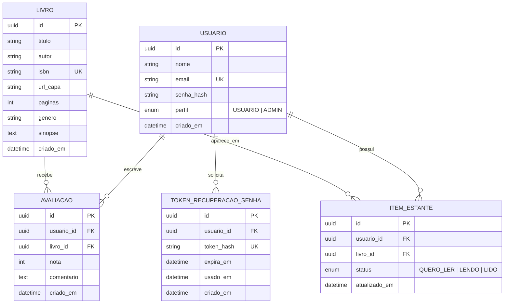

# Estante API

API REST em Node.js para catálogo de livros, avaliações e estante de leitura.

## Sobre o sistema

Leitores cadastram livros no catálogo, organizam sua estante pessoal (quero ler, lendo, lido) e avaliam os livros que já leram. Sistema da categoria **reviews**.

**API externa:** Open Library (busca de dados do livro por título para preencher o cadastro). _(a implementar)_

## Entidades

- **Usuário**: perfil `USUARIO` ou `ADMIN`.
- **Livro**: título, autor, ISBN, capa, páginas, gênero, sinopse.
- **Avaliação**: nota (1 a 5) e comentário de um usuário sobre um livro.
- **Item da estante**: status do livro para o usuário (`QUERO_LER`, `LENDO`, `LIDO`).

## DER



`AVALIACAO` e `ITEM_ESTANTE` têm par único (`usuario_id`, `livro_id`). A nota é limitada de 1 a 5 por uma restrição `CHECK` no banco. Ao excluir um usuário ou livro, suas avaliações e itens de estante são excluídos em cascata. `TOKEN_RECUPERACAO_SENHA` é uma tabela de apoio (guarda só o hash do token) e não conta como entidade de negócio.

## Regras de negócio e permissões

- Um usuário avalia um livro uma única vez, e só se ele estiver como `LIDO` na estante.
- O dono edita e exclui a própria avaliação; o `ADMIN` exclui qualquer uma.
- Só o `ADMIN` cadastra, edita e remove livros.
- A média das notas do livro é calculada a partir das avaliações.

## Banco de dados

PostgreSQL com [Prisma](https://www.prisma.io/). O esquema fica em `prisma/schema.prisma` e as migrations em `prisma/migrations/`. As migrations são aplicadas automaticamente quando o container da API inicia.

## Como executar

Pré-requisitos: Docker e Docker Compose.

1. Crie o arquivo de ambiente:

       cp .env.example .env

2. Edite o `.env` e troque os valores marcados com `[TROCAR]`: `BANCO_SENHA` (apenas letras e números), `SEGREDO_JWT` e `ADMIN_SENHA`. Para gerar um segredo JWT:

       node -e "console.log(require('crypto').randomBytes(48).toString('hex'))"

   (sem Node instalado, use qualquer sequência aleatória com 32 caracteres ou mais)

3. Suba o ambiente:

       docker compose up --build

Verificação: `GET http://localhost:3000/saude` deve retornar `{"status":"ok","banco":"conectado"}`.

| Serviço | Endereço |
|---|---|
| API | http://localhost:3000 |
| Mailpit (caixa de e-mails de teste) | http://localhost:8025 |
| Front-end (repositório `estante-web`) | http://localhost:5173 |

Observações:

- A senha do banco existe em um único lugar (`BANCO_SENHA`); a URL de conexão é montada pelo `docker-compose.yml`.
- O banco só lê usuário e senha na **primeira** criação. Se trocar `BANCO_USUARIO` ou `BANCO_SENHA` depois, rode `docker compose down -v` (apaga os dados locais) e suba de novo.
- O front-end precisa rodar no endereço de `URL_FRONTEND`. Se usar outra porta, altere essa variável e reinicie a API (do contrário o CORS bloqueia as chamadas).
- O administrador inicial é criado automaticamente com `ADMIN_EMAIL` e `ADMIN_SENHA` do `.env`.
- Testes automáticos (sem banco): `npm install && npm test`.

## Autenticação e permissões

Login por e-mail e senha com JWT (expira em `EXPIRACAO_JWT`). Rotas protegidas exigem o cabeçalho `Authorization: Bearer <token>`.

| Perfil | Pode |
|---|---|
| Visitante | Cadastrar-se, entrar e recuperar a senha |
| `USUARIO` | Ver a própria conta (`GET /auth/eu`) |
| `ADMIN` | Tudo do usuário, mais operações administrativas (ex.: `GET /usuarios`) |

Segurança aplicada: senhas com hash bcrypt; perfil nunca vem do cliente (todo cadastro é `USUARIO`); login responde a mesma mensagem para e-mail inexistente e senha errada; limite de tentativas nas rotas `/auth`; validação com Zod; cabeçalhos de segurança (Helmet); CORS restrito ao front; erros sem detalhes internos.

### Recuperação de senha

1. `POST /auth/esqueci-senha` com o e-mail. A resposta é sempre a mesma, exista ou não a conta.
2. A API gera um token aleatório, guarda **somente o hash** dele (válido por `VALIDADE_TOKEN_SENHA_MINUTOS`, uso único) e envia o link por e-mail. Um novo pedido invalida os anteriores.
3. O e-mail chega no Mailpit (http://localhost:8025) com o link `URL_FRONTEND/redefinir-senha?token=...`.
4. `POST /auth/redefinir-senha` com o token e a nova senha.

Limitação conhecida: os tokens JWT já emitidos continuam válidos até expirarem, mesmo depois de uma troca de senha.

## Endpoints

| Método e caminho | Acesso | Corpo | Respostas |
|---|---|---|---|
| `POST /auth/cadastro` | Público | `nome` (2-100), `email`, `senha` (8-72) | 201 `{usuario}`; 400 dados inválidos; 409 e-mail já cadastrado |
| `POST /auth/login` | Público | `email`, `senha` | 200 `{token, usuario}`; 401 credenciais inválidas |
| `POST /auth/esqueci-senha` | Público | `email` | 200 `{mensagem}` |
| `POST /auth/redefinir-senha` | Público | `token`, `novaSenha` (8-72) | 200 `{mensagem}`; 400 token inválido ou expirado |
| `GET /auth/eu` | Autenticado | (nenhum) | 200 `{usuario}`; 401 |
| `GET /usuarios` | `ADMIN` | (nenhum) | 200 `{usuarios}`; 401; 403 |
| `GET /saude` | Público | (nenhum) | 200 API e banco ok; 503 banco fora |

Exemplo de login:

    POST /auth/login
    {"email": "admin@estante.local", "senha": "sua_senha_admin"}

    200 OK
    {"token": "eyJhbGciOi...", "usuario": {"id": "...", "nome": "Administrador", "email": "admin@estante.local", "perfil": "ADMIN", "criadoEm": "..."}}

Todo erro tem o formato `{"erro": "mensagem"}`; erros de validação trazem também `detalhes` (lista de `campo` e `mensagem`).

## Estrutura (Clean Architecture)

```
src/
  dominio/          entidades e regras de negócio puras
  aplicacao/        casos de uso e interfaces (repositórios, serviços)
  infraestrutura/   banco, e-mail, API externa
  apresentacao/     rotas, controllers, middlewares (erros globais)
```

## Status

Semana 1: estrutura inicial, DER e ambiente Docker.
Semana 2: modelagem concluída, persistência com Prisma/PostgreSQL e migrations no Docker.
Semana 3: cadastro, login com JWT, perfis (USUARIO e ADMIN) e recuperação de senha por e-mail.
